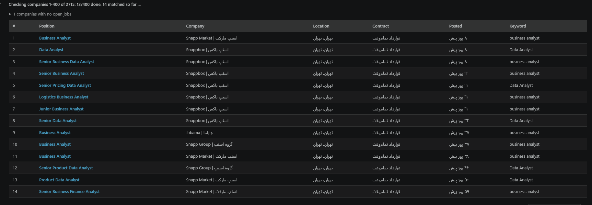
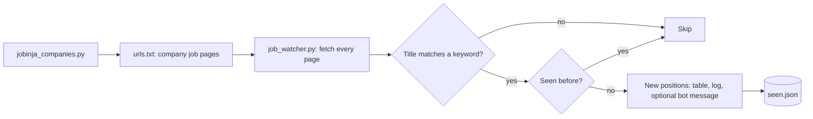

# Jobinja Job Watcher

Watches the career pages of 2,700+ companies on Jobinja and reports only the open positions that match my keywords and that I have not seen before.

<p align="center">
  
</p>

## Why I built it

Checking hundreds of company pages by hand does not happen, and job-board alerts either miss the companies I care about or flood me with roles I don't. This watches exactly the companies I choose and shows only what is new.

## What it does

- **Builds the company list.** `jobinja_companies.py` collects company pages from a Jobinja category, keeps companies in Tehran, and writes their job-list URLs.
- **Checks every company.** `job_watcher.py` pages through each company's open positions.
- **Matches like a human reads.** Every keyword word must appear in the title, in any order, with other words allowed between, so `business analyst` catches "Business Data Analyst". Put a keyword in quotes to require the exact phrase.
- **Handles Persian properly.** Spaces, half-spaces and Arabic/Persian letter variants never matter, so تحلیلگر, تحلیل گر and تحلیل‌گر are the same word.
- **Reports only what is new.** Past matches are remembered, and only new positions are reported and logged.
- **Fits the way I work.** A live HTML table with clickable titles in a notebook, plain output in the terminal, and an optional Telegram or Bale message.
- **Runs in chunks and stays gentle.** Check companies 1 to 100 now and 101 to 200 later. Two workers, with a pause after each request.

## How it works



## Keyword rules

| In `keywords.txt` | Matches |
|---|---|
| `business analyst` | Business Analyst, Business Data Analyst, Senior Business Systems Analyst |
| `"business analyst"` | Business Analyst only, words next to each other |
| `تحلیلگر کسب و کار` | تحلیلگر کسب‌وکار, تحلیل‌گر کسب و کار |

## Run it

```bash
pip install -r requirements.txt

python jobinja_companies.py 20        # build the company list (first 20 category pages)
python job_watcher.py                 # new positions only
python job_watcher.py --all           # every open match, new ones flagged
python job_watcher.py 1-100           # only companies 1 to 100
```

In a Jupyter or VS Code notebook: `%run job_watcher.py 1-100`

Optional bot notification, set environment variables:

```bash
JOB_BOT_TOKEN=...   JOB_CHAT_ID=...   JOB_BOT_API=https://api.telegram.org   # or https://tapi.bale.ai
```

## Tech

Python · requests · BeautifulSoup · concurrent.futures · Unicode normalization
